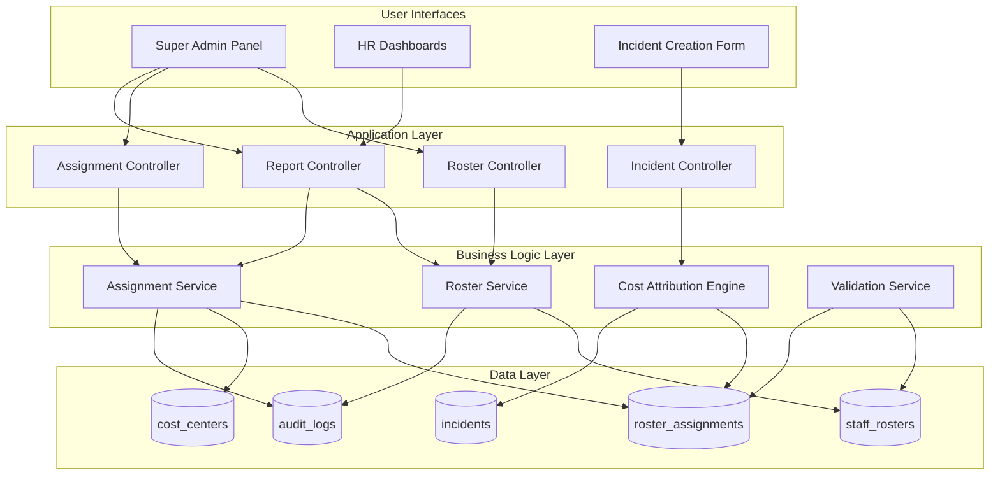
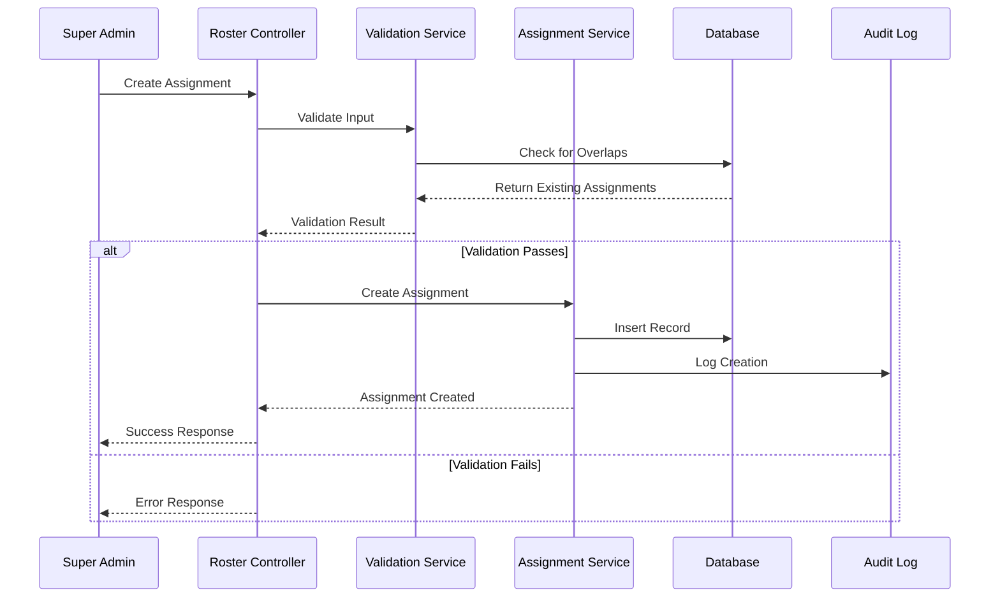
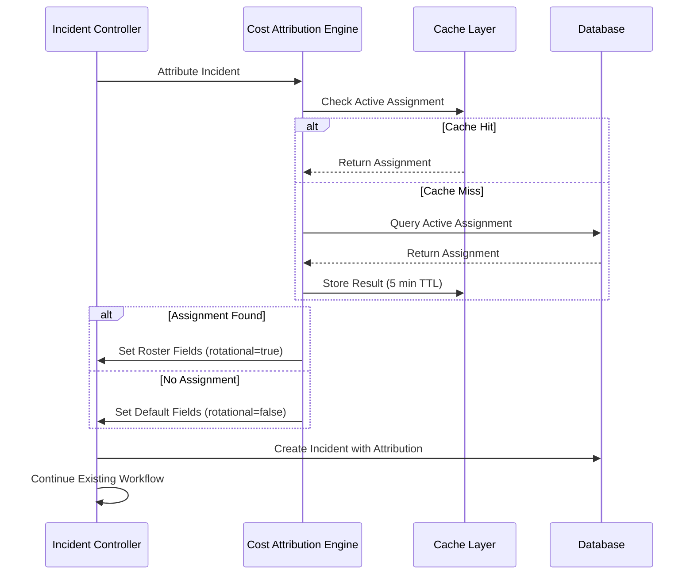

# Design Document: Multi-Facility Roster Mapping

## Overview

The Multi-Facility Roster Mapping system is a parallel tracking layer that operates alongside the existing incident management workflow. It enables accurate tracking of rotational staff, locum doctors, and nursing students across multiple facilities while maintaining precise cost center attribution for incidents without modifying existing workflow routing logic.

The system consists of three primary subsystems:
1. **Roster Management System** - CRUD operations for staff rosters and facility assignments
2. **Cost Attribution Engine** - Automatic determination of financial liability when incidents occur
3. **Reporting and Analytics** - Cost center reports and workforce planning insights

### Design Principles

- **Non-Invasive Integration**: The system must not modify existing incident workflow routing, supervisor assignment, or HR user assignment logic
- **Data Integrity**: Strict validation prevents overlapping assignments and ensures referential integrity
- **Performance First**: Active assignment lookups must complete in under 50ms to avoid slowing incident creation
- **Audit Trail**: All roster modifications are logged with user attribution and timestamps
- **Role-Based Access**: Read-only access for most roles, full CRUD only for Super Admins

## Architecture

### High-Level Architecture



### Integration with Existing System

The system integrates at a single point: incident creation. When an incident is created, the Cost Attribution Engine is invoked to:

1. Query for active roster assignments (non-blocking, < 50ms)
2. Populate roster-related fields on the incident record
3. Return control to the existing Incident Controller

**Critical**: The existing workflow routing logic (supervisor assignment, HR user assignment via load-balancing, notification dispatch) remains completely unchanged.

### Data Flow

#### Roster Assignment Creation Flow



#### Incident Cost Attribution Flow



## Components and Interfaces

### 1. Roster Service

**Responsibility**: Manage staff roster records (CRUD operations)

**Key Methods**:

```php
class RosterService
{
    /**
     * Create a new staff roster record
     * 
     * @param int $userId
     * @param string $staffType (permanent|locum|student|rotational)
     * @param int $primaryFacilityId
     * @param Carbon $startDate
     * @param Carbon|null $endDate
     * @param int $createdByUserId
     * @return StaffRoster
     * @throws ValidationException
     */
    public function createRoster(
        int $userId,
        string $staffType,
        int $primaryFacilityId,
        Carbon $startDate,
        ?Carbon $endDate,
        int $createdByUserId
    ): StaffRoster;
    
    /**
     * Update an existing roster record
     * 
     * @param int $rosterId
     * @param array $attributes
     * @param int $updatedByUserId
     * @return StaffRoster
     * @throws ValidationException
     */
    public function updateRoster(
        int $rosterId,
        array $attributes,
        int $updatedByUserId
    ): StaffRoster;
    
    /**
     * Mark a roster as inactive
     * 
     * @param int $rosterId
     * @param int $deactivatedByUserId
     * @return bool
     */
    public function deactivateRoster(
        int $rosterId,
        int $deactivatedByUserId
    ): bool;
    
    /**
     * Get roster by user ID
     * 
     * @param int $userId
     * @return Collection<StaffRoster>
     */
    public function getRostersByUserId(int $userId): Collection;
}
```

### 2. Assignment Service

**Responsibility**: Manage facility assignments with date ranges and overlap detection

**Key Methods**:

```php
class AssignmentService
{
    /**
     * Create a new facility assignment
     * 
     * @param int $staffRosterId
     * @param int $facilityId
     * @param Carbon $startDate
     * @param Carbon $endDate
     * @param int $costCenterFacilityId
     * @param string $assignmentType
     * @param int $createdByUserId
     * @return RosterAssignment
     * @throws OverlapException
     * @throws ValidationException
     */
    public function createAssignment(
        int $staffRosterId,
        int $facilityId,
        Carbon $startDate,
        Carbon $endDate,
        int $costCenterFacilityId,
        string $assignmentType,
        int $createdByUserId
    ): RosterAssignment;
    
    /**
     * Check for overlapping assignments
     * 
     * @param int $staffRosterId
     * @param int $facilityId
     * @param Carbon $startDate
     * @param Carbon $endDate
     * @param int|null $excludeAssignmentId
     * @return bool
     */
    public function hasOverlappingAssignment(
        int $staffRosterId,
        int $facilityId,
        Carbon $startDate,
        Carbon $endDate,
        ?int $excludeAssignmentId = null
    ): bool;
    
    /**
     * Get active assignment for a staff member at a facility on a specific date
     * 
     * @param int $userId
     * @param int $facilityId
     * @param Carbon $date
     * @return RosterAssignment|null
     */
    public function getActiveAssignment(
        int $userId,
        int $facilityId,
        Carbon $date
    ): ?RosterAssignment;
    
    /**
     * Update an existing assignment
     * 
     * @param int $assignmentId
     * @param array $attributes
     * @param int $updatedByUserId
     * @return RosterAssignment
     * @throws ValidationException
     */
    public function updateAssignment(
        int $assignmentId,
        array $attributes,
        int $updatedByUserId
    ): RosterAssignment;
    
    /**
     * Cancel an assignment
     * 
     * @param int $assignmentId
     * @param int $cancelledByUserId
     * @return bool
     */
    public function cancelAssignment(
        int $assignmentId,
        int $cancelledByUserId
    ): bool;
}
```

### 3. Cost Attribution Engine

**Responsibility**: Determine cost center attribution when incidents are created

**Key Methods**:

```php
class CostAttributionEngine
{
    /**
     * Attribute incident to appropriate cost center
     * 
     * @param int $userId (worker involved in incident)
     * @param int $incidentFacilityId (where incident occurred)
     * @param Carbon $incidentDate
     * @return array [
     *   'worker_primary_facility_id' => int,
     *   'cost_center_facility_id' => int,
     *   'roster_assignment_id' => int|null,
     *   'is_rotational_staff' => bool
     * ]
     */
    public function attributeIncident(
        int $userId,
        int $incidentFacilityId,
        Carbon $incidentDate
    ): array;
    
    /**
     * Get primary facility for a user
     * 
     * @param int $userId
     * @return int
     */
    private function getPrimaryFacilityId(int $userId): int;
    
    /**
     * Check if worker has active assignment (cached)
     * 
     * @param int $userId
     * @param int $facilityId
     * @param Carbon $date
     * @return RosterAssignment|null
     */
    private function getActiveAssignmentCached(
        int $userId,
        int $facilityId,
        Carbon $date
    ): ?RosterAssignment;
}
```

### 4. Validation Service

**Responsibility**: Validate roster and assignment data

**Key Methods**:

```php
class ValidationService
{
    /**
     * Validate roster creation data
     * 
     * @param array $data
     * @return array (validated data)
     * @throws ValidationException
     */
    public function validateRosterData(array $data): array;
    
    /**
     * Validate assignment creation data
     * 
     * @param array $data
     * @return array (validated data)
     * @throws ValidationException
     */
    public function validateAssignmentData(array $data): array;
    
    /**
     * Validate that start date is not more than 2 years in future
     * 
     * @param Carbon $startDate
     * @return bool
     * @throws ValidationException
     */
    public function validateStartDate(Carbon $startDate): bool;
    
    /**
     * Validate that end date is after start date
     * 
     * @param Carbon $startDate
     * @param Carbon $endDate
     * @return bool
     * @throws ValidationException
     */
    public function validateDateRange(Carbon $startDate, Carbon $endDate): bool;
    
    /**
     * Validate staff type enum
     * 
     * @param string $staffType
     * @return bool
     * @throws ValidationException
     */
    public function validateStaffType(string $staffType): bool;
    
    /**
     * Validate assignment type enum
     * 
     * @param string $assignmentType
     * @return bool
     * @throws ValidationException
     */
    public function validateAssignmentType(string $assignmentType): bool;
}
```

### 5. Report Service

**Responsibility**: Generate cost center reports and workforce analytics

**Key Methods**:

```php
class ReportService
{
    /**
     * Get incidents grouped by cost center
     * 
     * @param Carbon|null $startDate
     * @param Carbon|null $endDate
     * @return Collection
     */
    public function getIncidentsByCostCenter(
        ?Carbon $startDate = null,
        ?Carbon $endDate = null
    ): Collection;
    
    /**
     * Get workforce distribution by facility
     * 
     * @param Carbon $date
     * @return Collection
     */
    public function getWorkforceDistribution(Carbon $date): Collection;
    
    /**
     * Get rotation movements for a facility
     * 
     * @param int $facilityId
     * @param Carbon $startDate
     * @param Carbon $endDate
     * @return array ['incoming' => Collection, 'outgoing' => Collection]
     */
    public function getRotationMovements(
        int $facilityId,
        Carbon $startDate,
        Carbon $endDate
    ): array;
    
    /**
     * Export roster data to CSV
     * 
     * @param array $filters
     * @return string (CSV content)
     */
    public function exportRosterData(array $filters): string;
}
```

### 6. Audit Service

**Responsibility**: Log all roster-related changes

**Key Methods**:

```php
class AuditService
{
    /**
     * Log roster creation
     * 
     * @param StaffRoster $roster
     * @param int $userId
     * @return void
     */
    public function logRosterCreation(StaffRoster $roster, int $userId): void;
    
    /**
     * Log roster update
     * 
     * @param StaffRoster $roster
     * @param array $originalAttributes
     * @param int $userId
     * @return void
     */
    public function logRosterUpdate(
        StaffRoster $roster,
        array $originalAttributes,
        int $userId
    ): void;
    
    /**
     * Log assignment creation
     * 
     * @param RosterAssignment $assignment
     * @param int $userId
     * @return void
     */
    public function logAssignmentCreation(
        RosterAssignment $assignment,
        int $userId
    ): void;
    
    /**
     * Log assignment update
     * 
     * @param RosterAssignment $assignment
     * @param array $originalAttributes
     * @param int $userId
     * @return void
     */
    public function logAssignmentUpdate(
        RosterAssignment $assignment,
        array $originalAttributes,
        int $userId
    ): void;
    
    /**
     * Get audit logs for a roster
     * 
     * @param int $rosterId
     * @return Collection
     */
    public function getAuditLogs(int $rosterId): Collection;
}
```

## Data Models

### StaffRoster Model

```php
class StaffRoster extends Model
{
    protected $table = 'staff_rosters';
    
    protected $fillable = [
        'user_id',
        'staff_type',
        'primary_facility_id',
        'active',
        'start_date',
        'end_date',
        'notes',
        'created_by_user_id'
    ];
    
    protected $casts = [
        'active' => 'boolean',
        'start_date' => 'date',
        'end_date' => 'date'
    ];
    
    // Relationships
    public function user(): BelongsTo;
    public function primaryFacility(): BelongsTo;
    public function createdBy(): BelongsTo;
    public function assignments(): HasMany;
    
    // Scopes
    public function scopeActive($query);
    public function scopeByStaffType($query, string $type);
    public function scopeByFacility($query, int $facilityId);
}
```

### RosterAssignment Model

```php
class RosterAssignment extends Model
{
    protected $table = 'roster_assignments';
    
    protected $fillable = [
        'staff_roster_id',
        'facility_id',
        'assignment_start_date',
        'assignment_end_date',
        'cost_center_facility_id',
        'assignment_type',
        'supervisor_id',
        'status',
        'notes',
        'created_by_user_id'
    ];
    
    protected $casts = [
        'assignment_start_date' => 'date',
        'assignment_end_date' => 'date'
    ];
    
    // Relationships
    public function staffRoster(): BelongsTo;
    public function facility(): BelongsTo;
    public function costCenterFacility(): BelongsTo;
    public function supervisor(): BelongsTo;
    public function createdBy(): BelongsTo;
    public function incidents(): HasMany;
    
    // Scopes
    public function scopeActive($query);
    public function scopeActiveOn($query, Carbon $date);
    public function scopeAtFacility($query, int $facilityId);
    public function scopeByStatus($query, string $status);
}
```

### CostCenter Model

```php
class CostCenter extends Model
{
    protected $table = 'cost_centers';
    
    protected $fillable = [
        'facility_id',
        'cost_center_code',
        'cost_center_name',
        'is_active'
    ];
    
    protected $casts = [
        'is_active' => 'boolean'
    ];
    
    // Relationships
    public function facility(): BelongsTo;
    
    // Scopes
    public function scopeActive($query);
}
```

### Incident Model Extensions

```php
// Add to existing Incident model
class Incident extends Model
{
    // ... existing code ...
    
    protected $fillable = [
        // ... existing fields ...
        'worker_primary_facility_id',
        'cost_center_facility_id',
        'roster_assignment_id',
        'is_rotational_staff'
    ];
    
    protected $casts = [
        // ... existing casts ...
        'is_rotational_staff' => 'boolean'
    ];
    
    // New relationships
    public function workerPrimaryFacility(): BelongsTo;
    public function costCenterFacility(): BelongsTo;
    public function rosterAssignment(): BelongsTo;
    
    // New scopes
    public function scopeRotationalStaff($query);
    public function scopeByCostCenter($query, int $facilityId);
}
```

### Database Schema

#### staff_rosters table

```sql
CREATE TABLE staff_rosters (
    id BIGINT UNSIGNED AUTO_INCREMENT PRIMARY KEY,
    user_id BIGINT UNSIGNED NOT NULL,
    staff_type ENUM('permanent', 'locum', 'student', 'rotational') NOT NULL,
    primary_facility_id BIGINT UNSIGNED NOT NULL,
    active BOOLEAN DEFAULT TRUE,
    start_date DATE NOT NULL,
    end_date DATE NULL,
    notes TEXT NULL,
    created_by_user_id BIGINT UNSIGNED NOT NULL,
    created_at TIMESTAMP DEFAULT CURRENT_TIMESTAMP,
    updated_at TIMESTAMP DEFAULT CURRENT_TIMESTAMP ON UPDATE CURRENT_TIMESTAMP,
    
    FOREIGN KEY (user_id) REFERENCES users(id) ON DELETE RESTRICT,
    FOREIGN KEY (primary_facility_id) REFERENCES facilities(id) ON DELETE RESTRICT,
    FOREIGN KEY (created_by_user_id) REFERENCES users(id) ON DELETE RESTRICT,
    
    INDEX idx_user_id (user_id),
    INDEX idx_primary_facility_id (primary_facility_id),
    INDEX idx_staff_type (staff_type),
    INDEX idx_active (active)
);
```

#### roster_assignments table

```sql
CREATE TABLE roster_assignments (
    id BIGINT UNSIGNED AUTO_INCREMENT PRIMARY KEY,
    staff_roster_id BIGINT UNSIGNED NOT NULL,
    facility_id BIGINT UNSIGNED NOT NULL,
    assignment_start_date DATE NOT NULL,
    assignment_end_date DATE NOT NULL,
    cost_center_facility_id BIGINT UNSIGNED NOT NULL,
    assignment_type ENUM('rotation', 'locum_contract', 'student_placement') NOT NULL,
    supervisor_id BIGINT UNSIGNED NULL,
    status ENUM('active', 'completed', 'cancelled') DEFAULT 'active',
    notes TEXT NULL,
    created_by_user_id BIGINT UNSIGNED NOT NULL,
    created_at TIMESTAMP DEFAULT CURRENT_TIMESTAMP,
    updated_at TIMESTAMP DEFAULT CURRENT_TIMESTAMP ON UPDATE CURRENT_TIMESTAMP,
    
    FOREIGN KEY (staff_roster_id) REFERENCES staff_rosters(id) ON DELETE RESTRICT,
    FOREIGN KEY (facility_id) REFERENCES facilities(id) ON DELETE RESTRICT,
    FOREIGN KEY (cost_center_facility_id) REFERENCES facilities(id) ON DELETE RESTRICT,
    FOREIGN KEY (supervisor_id) REFERENCES users(id) ON DELETE SET NULL,
    FOREIGN KEY (created_by_user_id) REFERENCES users(id) ON DELETE RESTRICT,
    
    INDEX idx_staff_roster_id (staff_roster_id),
    INDEX idx_facility_id (facility_id),
    INDEX idx_dates (assignment_start_date, assignment_end_date),
    INDEX idx_cost_center (cost_center_facility_id),
    INDEX idx_status (status),
    INDEX idx_active_assignments (facility_id, assignment_start_date, assignment_end_date, status)
);
```

#### cost_centers table

```sql
CREATE TABLE cost_centers (
    id BIGINT UNSIGNED AUTO_INCREMENT PRIMARY KEY,
    facility_id BIGINT UNSIGNED NOT NULL,
    cost_center_code VARCHAR(50) NOT NULL,
    cost_center_name VARCHAR(255) NOT NULL,
    is_active BOOLEAN DEFAULT TRUE,
    created_at TIMESTAMP DEFAULT CURRENT_TIMESTAMP,
    updated_at TIMESTAMP DEFAULT CURRENT_TIMESTAMP ON UPDATE CURRENT_TIMESTAMP,
    
    FOREIGN KEY (facility_id) REFERENCES facilities(id) ON DELETE RESTRICT,
    
    UNIQUE KEY uk_cost_center_code (cost_center_code),
    INDEX idx_facility_id (facility_id),
    INDEX idx_is_active (is_active)
);
```

#### Incident table modifications

```sql
ALTER TABLE incidents
ADD COLUMN worker_primary_facility_id BIGINT UNSIGNED NULL,
ADD COLUMN cost_center_facility_id BIGINT UNSIGNED NULL,
ADD COLUMN roster_assignment_id BIGINT UNSIGNED NULL,
ADD COLUMN is_rotational_staff BOOLEAN DEFAULT FALSE,

ADD CONSTRAINT fk_incidents_worker_primary_facility 
    FOREIGN KEY (worker_primary_facility_id) REFERENCES facilities(id) ON DELETE RESTRICT,
    
ADD CONSTRAINT fk_incidents_cost_center_facility 
    FOREIGN KEY (cost_center_facility_id) REFERENCES facilities(id) ON DELETE RESTRICT,
    
ADD CONSTRAINT fk_incidents_roster_assignment 
    FOREIGN KEY (roster_assignment_id) REFERENCES roster_assignments(id) ON DELETE RESTRICT;

CREATE INDEX idx_incidents_worker_primary_facility ON incidents(worker_primary_facility_id);
CREATE INDEX idx_incidents_cost_center_facility ON incidents(cost_center_facility_id);
CREATE INDEX idx_incidents_roster_assignment ON incidents(roster_assignment_id);
CREATE INDEX idx_incidents_is_rotational_staff ON incidents(is_rotational_staff);
```

#### roster_audit_logs table

```sql
CREATE TABLE roster_audit_logs (
    id BIGINT UNSIGNED AUTO_INCREMENT PRIMARY KEY,
    auditable_type VARCHAR(255) NOT NULL,
    auditable_id BIGINT UNSIGNED NOT NULL,
    action_type ENUM('created', 'updated', 'deleted', 'deactivated', 'cancelled') NOT NULL,
    user_id BIGINT UNSIGNED NOT NULL,
    old_values JSON NULL,
    new_values JSON NULL,
    created_at TIMESTAMP DEFAULT CURRENT_TIMESTAMP,
    
    FOREIGN KEY (user_id) REFERENCES users(id) ON DELETE RESTRICT,
    
    INDEX idx_auditable (auditable_type, auditable_id),
    INDEX idx_user_id (user_id),
    INDEX idx_action_type (action_type),
    INDEX idx_created_at (created_at)
);
```


## Correctness Properties

*A property is a characteristic or behavior that should hold true across all valid executions of a system—essentially, a formal statement about what the system should do. Properties serve as the bridge between human-readable specifications and machine-verifiable correctness guarantees.*

### Property 1: Roster Record Persistence

*For any* valid roster creation request (with user_id, staff_type, primary_facility_id, start_date, and optional end_date), when the roster is created and then retrieved, all submitted fields should match the retrieved record exactly.

**Validates: Requirements 1.1**

### Property 2: Foreign Key Validation

*For any* roster or assignment creation request with invalid foreign key references (user_id, facility_id, cost_center_facility_id), the system should reject the request with a validation error.

**Validates: Requirements 1.2, 1.3, 11.3**

### Property 3: Staff Type Enum Validation

*For any* staff_type value not in the set {permanent, locum, student, rotational}, roster creation should be rejected with a validation error, and for any valid staff_type, the roster should be created successfully.

**Validates: Requirements 1.4**

### Property 4: Roster Update Preservation

*For any* existing roster and any valid update to staff_type, primary_facility_id, or active status, after the update is applied and the roster is retrieved, the updated fields should match the requested changes while non-updated fields remain unchanged.

**Validates: Requirements 1.5**

### Property 5: Soft Deletion via Inactive Status

*For any* active roster, when marked as inactive, the roster record should still exist in the database with active=false, and all historical data should be preserved.

**Validates: Requirements 1.6**

### Property 6: Audit Trail for Modifications

*For any* roster or assignment modification (create, update, deactivate, cancel), an audit log entry should be created containing the action type, the user_id of the user making the change, a timestamp, and the changed data.

**Validates: Requirements 1.7, 1.8, 10.1, 10.3, 10.4, 10.6**

### Property 7: Audit Log Before/After Values

*For any* roster or assignment update operation, the audit log entry should contain both the original values (before) and the new values (after) as JSON objects.

**Validates: Requirements 10.2, 10.5**

### Property 8: Assignment Field Persistence

*For any* valid assignment creation request with all required fields (staff_roster_id, facility_id, assignment dates, cost_center_facility_id, assignment_type), when the assignment is created and then retrieved, all submitted fields should match the retrieved record exactly.

**Validates: Requirements 2.1**

### Property 9: Date Range Validation

*For any* assignment with assignment_start_date more than 2 years in the future, the creation should be rejected, and for any assignment with assignment_end_date before or equal to assignment_start_date, the creation should be rejected.

**Validates: Requirements 2.2, 2.3, 11.1**

### Property 10: Overlap Detection

*For any* staff member with an existing active assignment at a facility within date range [start1, end1], attempting to create a new assignment at the same facility with overlapping date range [start2, end2] should be rejected with a specific overlap error.

**Validates: Requirements 2.4**

### Property 11: Assignment Type Enum Validation

*For any* assignment_type value not in the set {rotation, locum_contract, student_placement}, assignment creation should be rejected with a validation error.

**Validates: Requirements 2.5**

### Property 12: Assignment Update Preservation

*For any* existing assignment and any valid update to dates, cost_center_facility_id, or status, after the update is applied and the assignment is retrieved, the updated fields should match the requested changes while non-updated fields remain unchanged.

**Validates: Requirements 2.6**

### Property 13: Assignment Cancellation

*For any* active assignment, when cancelled by a Super Admin, the assignment status should be set to 'cancelled' and the record should still exist in the database.

**Validates: Requirements 2.7**

### Property 14: Active Assignment Date Filtering

*For any* query date and set of assignments, the returned active assignments should include all and only those assignments where the query date falls within [assignment_start_date, assignment_end_date] and status is not 'cancelled'.

**Validates: Requirements 3.1, 3.2**

### Property 15: Active Assignment Facility Filtering

*For any* facility_id and query date, the returned active assignments should include only assignments where facility_id matches the query facility and the query date falls within the assignment date range.

**Validates: Requirements 3.3**

### Property 16: Cache Invalidation on Assignment Changes

*For any* cached active assignment query result, when a roster assignment is created or modified, the cache entry for that user and facility combination should be invalidated.

**Validates: Requirements 12.5**

### Property 17: Rotational Staff Field Population

*For any* incident created when an active roster assignment exists for the worker at the incident location on the incident date, the incident should have worker_primary_facility_id set to the staff member's primary facility, cost_center_facility_id set to the assignment's cost center, roster_assignment_id set to the assignment's id, and is_rotational_staff set to true.

**Validates: Requirements 4.2, 4.3, 4.4, 4.5**

### Property 18: Non-Rotational Default Field Population

*For any* incident created when no active roster assignment exists for the worker at the incident location, the incident should have worker_primary_facility_id and cost_center_facility_id both set to the incident's facility_id, roster_assignment_id set to null, and is_rotational_staff set to false.

**Validates: Requirements 4.6, 4.7, 4.8**

### Property 19: Workflow Routing Independence

*For any* incident created with or without roster attribution, the assigned supervisor (assigned_supervisor_id) and routed HR user (routed_to_hr_user_id) should be determined solely by the incident's facility_id and facility type, without considering roster data.

**Validates: Requirements 4.10, 5.1, 5.2, 5.3, 5.5**

### Property 20: Notification Routing Independence

*For any* incident with roster attribution, notifications should be sent to users assigned based on the incident's facility_id location, not to users from the worker's primary facility or cost center facility.

**Validates: Requirements 5.4**

### Property 21: Authorization Enforcement for Roster Modifications

*For any* user without the Super_Admin role, attempts to create, update, or delete roster records or assignments should be rejected with an authorization error.

**Validates: Requirements 7.5, 7.6**

### Property 22: Cost Center Report Grouping

*For any* set of incidents with cost_center_facility_id values, the cost center report should group incidents by cost_center_facility_id and display worker_primary_facility_id, incident facility_id, cost_center_facility_id, and is_rotational_staff flag for each incident.

**Validates: Requirements 8.1, 8.2, 8.3**

### Property 23: Cost Center Report Statistics

*For any* set of incidents, the cost center summary statistics should correctly calculate total incident count, count of incidents where is_rotational_staff is true, and sum of incidents grouped by cost_center_facility_id.

**Validates: Requirements 8.5**

### Property 24: Roster Context Inclusion in Reports

*For any* incident where is_rotational_staff is true, the cost center report should include the linked roster assignment's context (assignment_type, date range, primary facility, cost center facility).

**Validates: Requirements 8.6**

### Property 25: Roster Context Display Content

*For any* incident where is_rotational_staff is true, the case dossier should display the worker's primary_facility name, cost_center_facility name, assignment_type, and assignment date range from the linked roster assignment.

**Validates: Requirements 9.2, 9.3, 9.4, 9.5**

### Property 26: Multiple Assignment Conflict Detection

*For any* staff member with multiple active assignments on the same date at different facilities, the system should flag this as a data error requiring Super Admin resolution.

**Validates: Requirements 11.2**

### Property 27: Historical Assignment Link Preservation

*For any* incident created during an active roster assignment, even if the assignment's end_date is later modified to extend beyond the incident date, the incident's roster_assignment_id link should remain unchanged.

**Validates: Requirements 11.5**

### Property 28: Referential Integrity Protection

*For any* roster record or assignment that is linked to one or more incidents (via roster_assignment_id), attempts to delete the roster or assignment should be rejected with a referential integrity error.

**Validates: Requirements 11.6, 11.7**

### Property 29: CSV Export Content Completeness

*For any* roster export request, the generated CSV should contain columns for staff name, staff_type, primary_facility, assigned_facility, assignment dates, cost_center, and status for all included assignments.

**Validates: Requirements 13.3**

### Property 30: Export Data Filtering

*For any* roster export request with filters (date range, facility, staff_type, district), the exported data should include only assignments matching all specified filter criteria.

**Validates: Requirements 13.4**

### Property 31: Workforce Distribution Report Accuracy

*For any* date and set of assignments, the workforce distribution report should correctly count staff members at each facility, including both permanent staff (primary_facility_id = facility) and rotational staff (active assignment at facility on that date).

**Validates: Requirements 13.5**

### Property 32: Rotation Movement Report Accuracy

*For any* facility and date range, the rotation pattern report should correctly identify incoming staff (assignments starting within the range at this facility) and outgoing staff (assignments ending within the range at this facility).

**Validates: Requirements 13.6**

### Property 33: Bulk Import Transaction Integrity

*For any* CSV import containing both valid and invalid roster records, if validation fails for any record, no records should be committed to the database (all-or-nothing transaction).

**Validates: Requirements 14.2**

### Property 34: Import Validation Error Reporting

*For any* CSV import with invalid records, the system should return a detailed error report identifying each invalid record by row number and listing all validation errors for that record.

**Validates: Requirements 14.3**

### Property 35: Backdated Assignment Non-Retroactivity

*For any* existing incident and subsequently created backdated roster assignment that would have been active at the incident date, the incident's roster attribution fields (worker_primary_facility_id, cost_center_facility_id, roster_assignment_id, is_rotational_staff) should remain unchanged.

**Validates: Requirements 14.5**

### Property 36: Historical Data Preservation

*For any* roster record or assignment, when related entities (staff members, facilities) are deleted or deactivated, the roster data should be preserved in the database for historical reference.

**Validates: Requirements 14.6**

## Error Handling

### Validation Errors

**Overlap Detection**:
- Error Code: `ROSTER_OVERLAP_ERROR`
- Message: "Assignment dates overlap with existing assignment [ID] at [Facility Name]"
- HTTP Status: 422 Unprocessable Entity

**Invalid Date Range**:
- Error Code: `INVALID_DATE_RANGE`
- Message: "Assignment end date must be after start date"
- HTTP Status: 422 Unprocessable Entity

**Future Date Limit**:
- Error Code: `DATE_TOO_FAR_FUTURE`
- Message: "Assignment start date cannot be more than 2 years in the future"
- HTTP Status: 422 Unprocessable Entity

**Invalid Enum Value**:
- Error Code: `INVALID_ENUM_VALUE`
- Message: "Invalid [field_name]. Must be one of: [valid_values]"
- HTTP Status: 422 Unprocessable Entity

**Foreign Key Violation**:
- Error Code: `INVALID_REFERENCE`
- Message: "[Entity] with ID [id] does not exist"
- HTTP Status: 422 Unprocessable Entity

### Authorization Errors

**Insufficient Permissions**:
- Error Code: `UNAUTHORIZED_ACTION`
- Message: "You do not have permission to perform this action"
- HTTP Status: 403 Forbidden

**Read-Only Access**:
- Error Code: `READ_ONLY_ACCESS`
- Message: "Your role has read-only access to roster data"
- HTTP Status: 403 Forbidden

### Data Integrity Errors

**Multiple Assignment Conflict**:
- Error Code: `MULTIPLE_ASSIGNMENT_CONFLICT`
- Message: "Staff member has multiple active assignments on [date]. Super Admin resolution required."
- HTTP Status: 409 Conflict

**Referential Integrity Violation**:
- Error Code: `CANNOT_DELETE_LINKED_RECORD`
- Message: "Cannot delete [entity] because it is linked to [count] incident(s)"
- HTTP Status: 409 Conflict

### Performance Errors

**Query Timeout**:
- Error Code: `QUERY_TIMEOUT`
- Message: "Active assignment lookup exceeded time limit"
- HTTP Status: 504 Gateway Timeout
- Fallback: Proceed with incident creation using default attribution (non-rotational)

**Cache Failure**:
- Error Code: `CACHE_ERROR`
- Message: "Cache service unavailable"
- HTTP Status: 200 OK (degrade gracefully, query database directly)

### Import Errors

**Import Validation Failed**:
- Error Code: `IMPORT_VALIDATION_FAILED`
- Message: "Import validation failed. See error report for details."
- HTTP Status: 422 Unprocessable Entity
- Response Body: JSON array of errors with row numbers and failure reasons

**Import Transaction Failure**:
- Error Code: `IMPORT_TRANSACTION_FAILED`
- Message: "Database transaction failed during import. No records were saved."
- HTTP Status: 500 Internal Server Error

### Error Handling Strategy

**Graceful Degradation**:
- If active assignment lookup fails (timeout, database error), incident creation proceeds with default attribution (non-rotational)
- If cache is unavailable, queries fall back to database
- If audit logging fails, operation still succeeds but failure is logged to system logs

**Transaction Rollback**:
- All roster/assignment creation and updates wrapped in database transactions
- Validation failures trigger rollback
- Audit logs created within same transaction to ensure consistency

**User-Friendly Error Messages**:
- All validation errors include specific field names and reasons
- Error responses include suggestions for resolution where applicable
- Bulk import errors include row numbers for easy correction

## Testing Strategy

The testing strategy employs a dual approach using both unit tests and property-based tests to ensure comprehensive coverage.

### Unit Tests

Unit tests focus on specific examples, edge cases, and integration points:

**Roster Management**:
- Test creating roster with all field combinations
- Test updating specific fields individually
- Test marking roster as inactive preserves data
- Test deactivating roster with existing assignments

**Assignment Management**:
- Test creating assignment with minimum required fields
- Test updating assignment dates
- Test cancelling assignment
- Test overlap detection with various date patterns
- Edge case: assignment ending on the same day another starts
- Edge case: assignment spanning multiple years

**Cost Attribution**:
- Test incident creation with active assignment
- Test incident creation without assignment
- Test incident at primary facility (should not be rotational)
- Edge case: incident on assignment start date
- Edge case: incident on assignment end date
- Edge case: multiple assignments at different facilities

**Authorization**:
- Test Super Admin can perform all operations
- Test Central HR has read-only access nationally
- Test District HR limited to district scope
- Test Hospital HR limited to facility scope
- Test HSC Conditions has read-only access
- Test unauthorized users receive 403 errors

**Workflow Integration**:
- Test supervisor assignment based on incident location
- Test HR user assignment via load-balancing
- Test notifications sent to location-based users
- Test dashboard filtering unchanged

**Routes and UI**:
- Test all roster management routes are accessible
- Test roster context displays in case dossier
- Test cost center reports render correctly
- Test CSV export downloads successfully

**Performance**:
- Test active assignment query completes within 50ms
- Test incident attribution adds < 100ms overhead
- Test cache improves query performance
- Test database indexes exist

### Property-Based Tests

Property-based tests verify universal properties across all inputs using randomized test data. Each test should run minimum 100 iterations.

**Testing Library**: Use **FastCheck** (JavaScript/TypeScript), **Hypothesis** (Python), or **QuickCheck** (PHP via phpunit-quickcheck)

**Test Configuration**:
```php
// Example configuration for PHP
class RosterPropertyTest extends TestCase
{
    protected $iterations = 100;
    
    /** @test */
    public function property_roster_persistence()
    {
        // Tag: Feature: multi-facility-roster-mapping, Property 1: Roster Record Persistence
        $this->forAll(
            $this->validRosterGenerator(),
            function($rosterData) {
                $roster = $this->rosterService->createRoster(...$rosterData);
                $retrieved = $this->rosterService->getRoster($roster->id);
                $this->assertEquals($rosterData, $retrieved->toArray());
            }
        );
    }
}
```

**Property Test Implementation**:

1. **Property 1: Roster Record Persistence**
   - Tag: *Feature: multi-facility-roster-mapping, Property 1: Roster Record Persistence*
   - Generator: Valid user_id, staff_type from enum, valid facility_id, random dates
   - Test: Create roster, retrieve, assert all fields match

2. **Property 2: Foreign Key Validation**
   - Tag: *Feature: multi-facility-roster-mapping, Property 2: Foreign Key Validation*
   - Generator: Invalid user_id, facility_id, cost_center_facility_id (negative, non-existent)
   - Test: Attempt creation, assert validation error

3. **Property 3: Staff Type Enum Validation**
   - Tag: *Feature: multi-facility-roster-mapping, Property 3: Staff Type Enum Validation*
   - Generator: Random strings not in {permanent, locum, student, rotational}
   - Test: Attempt creation with invalid staff_type, assert rejection

4. **Property 4: Roster Update Preservation**
   - Tag: *Feature: multi-facility-roster-mapping, Property 4: Roster Update Preservation*
   - Generator: Existing roster, valid update fields
   - Test: Update roster, retrieve, assert only updated fields changed

5. **Property 5: Soft Deletion via Inactive Status**
   - Tag: *Feature: multi-facility-roster-mapping, Property 5: Soft Deletion via Inactive Status*
   - Generator: Active roster
   - Test: Mark inactive, assert roster still exists with active=false

6. **Property 6: Audit Trail for Modifications**
   - Tag: *Feature: multi-facility-roster-mapping, Property 6: Audit Trail for Modifications*
   - Generator: Random roster/assignment operations
   - Test: Perform operation, assert audit log exists with correct action type and user_id

7. **Property 7: Audit Log Before/After Values**
   - Tag: *Feature: multi-facility-roster-mapping, Property 7: Audit Log Before/After Values*
   - Generator: Random roster/assignment updates
   - Test: Update record, assert audit log contains original and new values

8. **Property 8: Assignment Field Persistence**
   - Tag: *Feature: multi-facility-roster-mapping, Property 8: Assignment Field Persistence*
   - Generator: Valid assignment data
   - Test: Create assignment, retrieve, assert all fields match

9. **Property 9: Date Range Validation**
   - Tag: *Feature: multi-facility-roster-mapping, Property 9: Date Range Validation*
   - Generator: Invalid date ranges (start > end, start > 2 years future)
   - Test: Attempt creation, assert validation error

10. **Property 10: Overlap Detection**
    - Tag: *Feature: multi-facility-roster-mapping, Property 10: Overlap Detection*
    - Generator: Existing assignment, overlapping date range
    - Test: Attempt creation, assert overlap error

11. **Property 11: Assignment Type Enum Validation**
    - Tag: *Feature: multi-facility-roster-mapping, Property 11: Assignment Type Enum Validation*
    - Generator: Random strings not in {rotation, locum_contract, student_placement}
    - Test: Attempt creation, assert validation error

12. **Property 12: Assignment Update Preservation**
    - Tag: *Feature: multi-facility-roster-mapping, Property 12: Assignment Update Preservation*
    - Generator: Existing assignment, valid update fields
    - Test: Update assignment, retrieve, assert only updated fields changed

13. **Property 13: Assignment Cancellation**
    - Tag: *Feature: multi-facility-roster-mapping, Property 13: Assignment Cancellation*
    - Generator: Active assignment
    - Test: Cancel assignment, assert status='cancelled' and record exists

14. **Property 14: Active Assignment Date Filtering**
    - Tag: *Feature: multi-facility-roster-mapping, Property 14: Active Assignment Date Filtering*
    - Generator: Random assignments with various date ranges, random query date
    - Test: Query active assignments, assert only assignments containing query date are returned

15. **Property 15: Active Assignment Facility Filtering**
    - Tag: *Feature: multi-facility-roster-mapping, Property 15: Active Assignment Facility Filtering*
    - Generator: Assignments at multiple facilities, random facility_id and date
    - Test: Query active assignments, assert only matching facility assignments returned

16. **Property 16: Cache Invalidation on Assignment Changes**
    - Tag: *Feature: multi-facility-roster-mapping, Property 16: Cache Invalidation on Assignment Changes*
    - Generator: Random assignment modifications
    - Test: Cache query result, modify assignment, verify cache is invalidated

17. **Property 17: Rotational Staff Field Population**
    - Tag: *Feature: multi-facility-roster-mapping, Property 17: Rotational Staff Field Population*
    - Generator: Active roster assignment, incident at assignment facility
    - Test: Create incident, assert roster fields populated correctly and is_rotational_staff=true

18. **Property 18: Non-Rotational Default Field Population**
    - Tag: *Feature: multi-facility-roster-mapping, Property 18: Non-Rotational Default Field Population*
    - Generator: Incident without active assignment
    - Test: Create incident, assert roster fields default to incident facility and is_rotational_staff=false

19. **Property 19: Workflow Routing Independence**
    - Tag: *Feature: multi-facility-roster-mapping, Property 19: Workflow Routing Independence*
    - Generator: Incidents with and without roster data at same facility
    - Test: Create incidents, assert assigned_supervisor_id and routed_to_hr_user_id are identical

20. **Property 20: Notification Routing Independence**
    - Tag: *Feature: multi-facility-roster-mapping, Property 20: Notification Routing Independence*
    - Generator: Incident with roster attribution
    - Test: Trigger notification, assert recipients based on incident facility_id only

21. **Property 21: Authorization Enforcement for Roster Modifications**
    - Tag: *Feature: multi-facility-roster-mapping, Property 21: Authorization Enforcement for Roster Modifications*
    - Generator: Users without Super_Admin role, random roster operations
    - Test: Attempt operation, assert authorization error

22. **Property 22: Cost Center Report Grouping**
    - Tag: *Feature: multi-facility-roster-mapping, Property 22: Cost Center Report Grouping*
    - Generator: Incidents with various cost_center_facility_id values
    - Test: Generate report, assert incidents grouped correctly and required fields displayed

23. **Property 23: Cost Center Report Statistics**
    - Tag: *Feature: multi-facility-roster-mapping, Property 23: Cost Center Report Statistics*
    - Generator: Random set of incidents (some rotational, some not)
    - Test: Generate summary, assert counts match expected calculations

24. **Property 24: Roster Context Inclusion in Reports**
    - Tag: *Feature: multi-facility-roster-mapping, Property 24: Roster Context Inclusion in Reports*
    - Generator: Incidents where is_rotational_staff=true
    - Test: Generate report, assert roster assignment context is included

25. **Property 25: Roster Context Display Content**
    - Tag: *Feature: multi-facility-roster-mapping, Property 25: Roster Context Display Content*
    - Generator: Incident with is_rotational_staff=true
    - Test: Render case dossier, assert primary facility, cost center, assignment_type, and dates are displayed

26. **Property 26: Multiple Assignment Conflict Detection**
    - Tag: *Feature: multi-facility-roster-mapping, Property 26: Multiple Assignment Conflict Detection*
    - Generator: Multiple active assignments for same staff on same date at different facilities
    - Test: Attempt creation, assert conflict error

27. **Property 27: Historical Assignment Link Preservation**
    - Tag: *Feature: multi-facility-roster-mapping, Property 27: Historical Assignment Link Preservation*
    - Generator: Incident during active assignment, later modify assignment end_date
    - Test: Modify assignment, assert incident roster_assignment_id unchanged

28. **Property 28: Referential Integrity Protection**
    - Tag: *Feature: multi-facility-roster-mapping, Property 28: Referential Integrity Protection*
    - Generator: Roster/assignment linked to incidents
    - Test: Attempt deletion, assert referential integrity error

29. **Property 29: CSV Export Content Completeness**
    - Tag: *Feature: multi-facility-roster-mapping, Property 29: CSV Export Content Completeness*
    - Generator: Random roster assignments
    - Test: Export to CSV, parse, assert all required columns present with correct data

30. **Property 30: Export Data Filtering**
    - Tag: *Feature: multi-facility-roster-mapping, Property 30: Export Data Filtering*
    - Generator: Assignments with various attributes, random filter criteria
    - Test: Export with filters, assert only matching records in output

31. **Property 31: Workforce Distribution Report Accuracy**
    - Tag: *Feature: multi-facility-roster-mapping, Property 31: Workforce Distribution Report Accuracy*
    - Generator: Random date, various staff assignments (permanent and rotational)
    - Test: Generate report, assert staff counts match expected (primary + active rotational)

32. **Property 32: Rotation Movement Report Accuracy**
    - Tag: *Feature: multi-facility-roster-mapping, Property 32: Rotation Movement Report Accuracy*
    - Generator: Facility, date range, assignments starting/ending in range
    - Test: Generate report, assert incoming/outgoing lists match expected

33. **Property 33: Bulk Import Transaction Integrity**
    - Tag: *Feature: multi-facility-roster-mapping, Property 33: Bulk Import Transaction Integrity*
    - Generator: CSV with mix of valid and invalid records
    - Test: Import, assert no records committed if any validation fails

34. **Property 34: Import Validation Error Reporting**
    - Tag: *Feature: multi-facility-roster-mapping, Property 34: Import Validation Error Reporting*
    - Generator: CSV with multiple types of validation errors
    - Test: Import, assert error report contains row numbers and specific error reasons

35. **Property 35: Backdated Assignment Non-Retroactivity**
    - Tag: *Feature: multi-facility-roster-mapping, Property 35: Backdated Assignment Non-Retroactivity*
    - Generator: Existing incident, backdated assignment that would have been active
    - Test: Create backdated assignment, assert incident roster fields unchanged

36. **Property 36: Historical Data Preservation**
    - Tag: *Feature: multi-facility-roster-mapping, Property 36: Historical Data Preservation*
    - Generator: Roster/assignment, related entity deletion
    - Test: Delete related entity, assert roster data still exists in database

### Integration Tests

Integration tests verify the system works correctly across multiple components:

- Test complete roster creation flow from UI through service to database
- Test incident creation triggering cost attribution
- Test cost center report generation with database queries
- Test bulk import with file upload
- Test CSV export with streaming response
- Test cache integration with Redis/Memcached
- Test audit log creation across multiple operations

### Test Data Generators

**Roster Generator**:
```php
protected function validRosterGenerator(): Generator
{
    return new Generator([
        'user_id' => new IntegerGenerator(['min' => 1, 'max' => 1000]),
        'staff_type' => new ChoiceGenerator(['permanent', 'locum', 'student', 'rotational']),
        'primary_facility_id' => new IntegerGenerator(['min' => 1, 'max' => 50]),
        'start_date' => new DateGenerator(['min' => '-1 year', 'max' => 'now']),
        'end_date' => new OptionalGenerator(new DateGenerator(['min' => 'now', 'max' => '+2 years']))
    ]);
}
```

**Assignment Generator**:
```php
protected function validAssignmentGenerator(): Generator
{
    return new Generator([
        'staff_roster_id' => new ExistingRosterGenerator(),
        'facility_id' => new IntegerGenerator(['min' => 1, 'max' => 50]),
        'assignment_start_date' => new DateGenerator(['min' => 'now', 'max' => '+6 months']),
        'assignment_end_date' => new DateGenerator(['min' => '+6 months', 'max' => '+18 months']),
        'cost_center_facility_id' => new IntegerGenerator(['min' => 1, 'max' => 50]),
        'assignment_type' => new ChoiceGenerator(['rotation', 'locum_contract', 'student_placement'])
    ]);
}
```

### Test Execution

**Unit Tests**:
```bash
php artisan test --testsuite=Unit --filter=Roster
```

**Property Tests**:
```bash
php artisan test --testsuite=Property --filter=Roster
```

**Integration Tests**:
```bash
php artisan test --testsuite=Integration --filter=Roster
```

**Performance Tests**:
```bash
php artisan test:performance --filter=ActiveAssignmentQuery
```

### Continuous Integration

- All tests run on every commit
- Property tests run with 100 iterations in CI
- Performance tests run nightly to detect regressions
- Test coverage target: 90% for business logic, 80% overall
