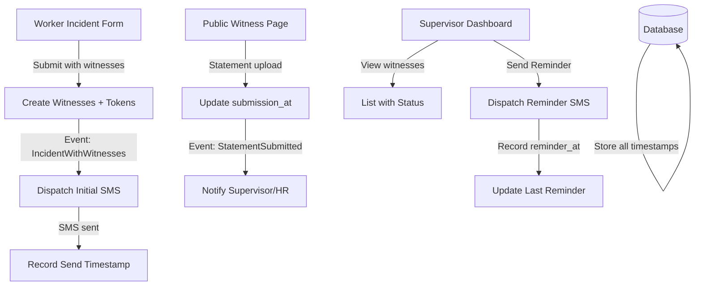

# Design Document: Witness Collection Workflow Redesign

## Overview

The witness collection workflow is redesigned to shift responsibility from supervisors to workers and witnesses themselves. Instead of supervisors manually entering witness details, workers provide witness information during incident reporting, triggering immediate automated SMS notifications. Supervisors transition from data entry to monitoring and follow-up coordination. The system tracks all SMS communications, statement submissions, and provides supervisors with a clear interface to monitor progress and send reminders.

The implementation consists of:
1. Enhanced incident report form with witness collection fields
2. Automated SMS dispatch system using Econet service
3. Witness token generation and public submission links
4. Supervisor dashboard for monitoring and reminders
5. Database schema enhancements for tracking timelines

## Architecture



**Key Components:**

1. **Witness Form Module**: Extended incident report form accepting witness details
2. **SMS Dispatch Service**: Handles initial notifications and reminders via Econet
3. **Witness Token System**: Generates secure identifiers for public access
4. **Supervisor Dashboard**: React/Blade component for monitoring and actions
5. **Notification Tracker**: Records all SMS sends with status and timestamps
6. **Database Layer**: Schema updates for tracking fields

## Components and Interfaces

### 1. Witness Collection in Incident Form

**Location**: `resources/views/incidents/incident_report.blade.php` (or equivalent form)

**Functionality**:
- Add two witness input fields (name, phone) in the form
- Client-side validation for non-empty fields
- Server-side persistence to witness records
- Form submission validation ensures both witnesses have complete data

**Interface**:
```php
// Witness form inputs
- Witness 1 Name (text input, required if witness added)
- Witness 1 Phone (tel input, required if witness added)
- Witness 2 Name (text input, optional)
- Witness 2 Phone (tel input, optional)
- Add/Remove buttons for witness fields
```

### 2. Witness Token Generation

**Location**: `app/Http/Controllers/IncidentController.php` (method: `storeWithWitnesses()`)

**Functionality**:
- On form submit, create `WitnessToken` records for each witness
- Generate secure random tokens using Laravel's `Str::random()`
- Store: incident_id, witness_name, phone_number, witness_token, created_at
- Set initial status: token_sent_at = null

**Database Model**:
```php
class WitnessToken extends Model {
    protected $fillable = [
        'incident_id',
        'witness_name', 
        'phone_number',
        'witness_token',
        'token_sent_at',
        'witness_statement_submitted_at',
        'witness_last_reminder_sent_at'
    ];
}
```

### 3. SMS Dispatch Service

**Location**: `app/Services/WitnessSMSService.php`

**Key Methods**:
- `sendInitialNotification($witnessToken, $incident)`: Sends initial SMS to witness
- `sendReminder($witnessToken, $incident)`: Sends reminder SMS
- `formatSMSMessage($incident, $type)`: Creates message content
- `handleSMSFailure($witnessToken, $error)`: Logs failure for retry

**Responsibilities**:
- Uses existing SMS service (`app/Services/SMSService.php`)
- Constructs public link: `/incidents/{incident_id}/witness/{token}`
- Handles rate limiting and error handling
- Records send timestamps and status

### 4. Event and Listener

**Event**: `IncidentWithWitnessesSubmitted` (new)
- Fired after incident + witnesses saved successfully
- Contains: incident, witness collection

**Listener**: `SendWitnessNotifications`
- Handles event dispatch
- Iterates witnesses and sends SMS
- Records send status
- Updates `token_sent_at` timestamp

### 5. Supervisor Witness Dashboard

**Location**: `resources/views/incidents/supervisor_witness_dashboard.blade.php` (enhanced)

**Display Elements**:
- Incident reference and basic info
- Witness count (submitted/total)
- Table with columns:
  - Witness Name
  - Phone Number
  - Status Badge (Pending/Submitted)
  - Submission Date (if submitted)
  - Last Reminder Sent (if applicable)
  - Actions (View Statement / Send Reminder)

**Functionality**:
- Show "Pending" badge for `witness_statement_submitted_at = null`
- Show "Submitted" badge with date for `witness_statement_submitted_at > null`
- Display statement download link when available
- Send Reminder button → triggers SMS dispatch

### 6. Reminder SMS Handler

**Location**: `app/Http/Controllers/IncidentController.php` (method: `sendWitnessReminder()`)

**Endpoint**: `POST /supervisor/incidents/{incident}/witness/{tokenId}/reminder`

**Functionality**:
- Verify supervisor authorization
- Check witness has not submitted
- Dispatch reminder SMS
- Update `witness_last_reminder_sent_at`
- Log action to notification tracker
- Return success/failure response

### 7. Public Witness Submission Page

**Location**: `resources/views/incidents/witness_statement.blade.php` (existing, no changes needed)

**On Document Upload**:
- Current flow: uploads document via `publicUploadDocuments()`
- Enhancement: After upload, update `witness_statement_submitted_at` = now()
- Trigger event: `WitnessStatementSubmitted`
- Event listener notifies supervisor/HR

## Data Models

### WitnessToken Model

```php
class WitnessToken extends Model {
    protected $table = 'witness_tokens';
    
    protected $fillable = [
        'incident_id',
        'witness_name',
        'phone_number',
        'witness_token',
        'token_sent_at',
        'witness_statement_submitted_at',
        'witness_last_reminder_sent_at'
    ];
    
    protected $casts = [
        'token_sent_at' => 'datetime',
        'witness_statement_submitted_at' => 'datetime',
        'witness_last_reminder_sent_at' => 'datetime'
    ];
    
    public function incident() {
        return $this->belongsTo(Incident::class);
    }
    
    public function hasSubmitted(): bool {
        return $this->witness_statement_submitted_at !== null;
    }
    
    public function isPending(): bool {
        return !$this->hasSubmitted();
    }
}
```

### IncidentAttachment Model (Enhanced)

Update the model to track submission source:

```php
// In IncidentAttachment model, add:
public function witnessToken() {
    return $this->belongsTo(WitnessToken::class, 'witness_token_id');
}
```

### SMS Notification Log

```php
class IncidentNotification extends Model {
    protected $fillable = [
        'incident_id',
        'witness_token_id',
        'notification_type', // INITIAL_SMS, REMINDER_SMS, STATEMENT_SUBMITTED
        'notification_channel', // sms, email, database
        'recipient_phone',
        'status', // SENT, FAILED, PENDING
        'message_content',
        'sent_at',
        'error_message'
    ];
}
```

## Error Handling

**SMS Send Failures**:
- Log error with timestamp and error message
- Do not block form submission
- Allow supervisor to retry from dashboard
- Display failure notification in supervisor interface
- Implement exponential backoff for retries

**Token Expiration** (future enhancement):
- Consider token expiration after 30 days
- Show "Link Expired" status in supervisor view
- Allow resending with new token

**Invalid Phone Numbers**:
- Validate format before save (basic: +263 format or 07xx)
- Show validation error if invalid
- Allow supervisor to edit and retry

**Network Failures**:
- Retry logic with exponential backoff (max 3 retries)
- Log all attempts
- Notify supervisor of persistent failures

## Testing Strategy

### Unit Tests

**Witness Token Generation**:
- Test token uniqueness
- Test all required fields are saved
- Test validation of phone number format
- Test witness count limits (max 2)

**SMS Message Formatting**:
- Test message includes incident reference
- Test message includes public link
- Test message length
- Test phone number formatting

**Dashboard Display**:
- Test witness list renders correctly
- Test status badges display based on submission status
- Test submission date displays when submitted
- Test last reminder date displays when sent

**Submission Tracking**:
- Test `witness_statement_submitted_at` updates on upload
- Test `witness_last_reminder_sent_at` updates on reminder send
- Test timestamps are accurate

### Property-Based Tests

These will be implemented as sub-tasks during task creation.

## Correctness Properties

A property is a characteristic or behavior that should hold true across all valid executions of a system—essentially, a formal statement about what the system should do. Properties serve as the bridge between human-readable specifications and machine-verifiable correctness guarantees.

**Property 1: Witness SMS Delivery Idempotence**

For any incident with witnesses, sending the initial SMS notifications multiple times should result in the same delivery status (no duplicate sends to the same witness unless explicitly retried).

**Validates: Requirements 2.1, 2.3, 2.4**

**Property 2: Submission Status Round Trip**

For any witness token with `witness_statement_submitted_at = null`, after a statement is uploaded by that witness, querying the token should return `witness_statement_submitted_at != null`. The submission timestamp should persist across reads.

**Validates: Requirements 6.1, 6.3, 6.4**

**Property 3: Reminder Timestamp Preservation**

For any witness token, when a reminder SMS is sent, the `witness_last_reminder_sent_at` should be updated to the current time. Sending additional reminders should update the timestamp to later values, maintaining a strictly increasing sequence.

**Validates: Requirements 4.3, 5.2, 5.5**

**Property 4: Witness List Consistency**

For any incident with N witnesses, the supervisor dashboard should display exactly N witness records with all their details (name, phone, status). No witnesses should be missing or duplicated.

**Validates: Requirements 3.1, 3.2, 3.5**

**Property 5: SMS History Completeness**

For any witness, all SMS send events (initial notification, reminders, failed attempts) should be logged in the notification tracker with timestamps. The count of logged events should match the actual number of send operations performed.

**Validates: Requirements 5.1, 5.2, 5.3, 5.4**

**Property 6: Supervisor Authorization Boundary**

For any supervisor and any incident they are responsible for, they should be able to view and manage witnesses for that incident. For any incident they are NOT responsible for, they should not be able to access or modify witness data.

**Validates: Requirement 9.1, 9.2**

## Configuration and Environment

**Required Environment Variables**:
```
SMS_ENABLED=true
ECONET_SMS_API_KEY=[key]
ECONET_SMS_BASE_URL=https://mobilemessaging.econet.co.zw
ECONET_SMS_SENDER_ID="HSC SMS"
```

**Queue Setup** (for async SMS dispatch):
- Use Laravel queues for sending SMS (don't block form submission)
- Queue job: `SendWitnessNotificationSMS`
- Retry policy: 3 retries with exponential backoff

**Database Migrations**:
- Create `witness_tokens` table with all required fields
- Add new fields to existing `witness_attachments` or similar table if tracking statements
- Create `incident_notifications` table for SMS history

## Performance Considerations

- **Async SMS**: Queue SMS sends to avoid blocking form submission
- **Pagination**: If many witnesses per incident, implement pagination in supervisor dashboard
- **Caching**: Cache incident reference lookups briefly
- **Query Optimization**: Use eager loading for witness relationships

## Future Enhancements

1. **Bulk SMS to Multiple Incidents**: Send reminders across multiple incidents at once
2. **SMS Scheduling**: Allow supervisors to schedule reminder sends for a specific time
3. **SMS Templates**: Configurable message templates per facility
4. **Two-Way SMS**: Accept replies from witnesses (optional acknowledgment)
5. **Email Fallback**: Send email if SMS fails or phone number invalid
6. **Automated Reminders**: Schedule automatic reminders after X days with no submission
7. **Witness List Export**: Export witness data with submission status to CSV/PDF
8. **Notification Preferences**: Allow supervisors to customize notification channels

